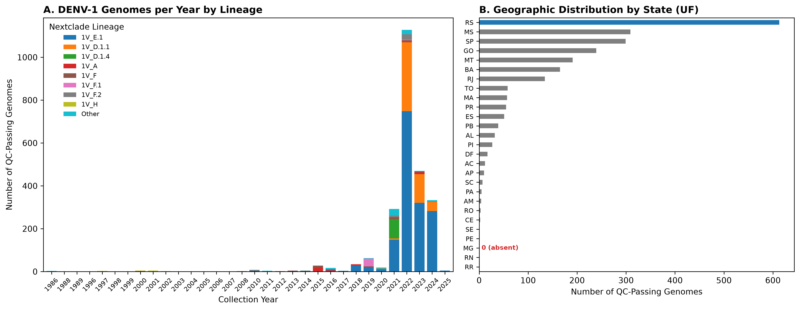
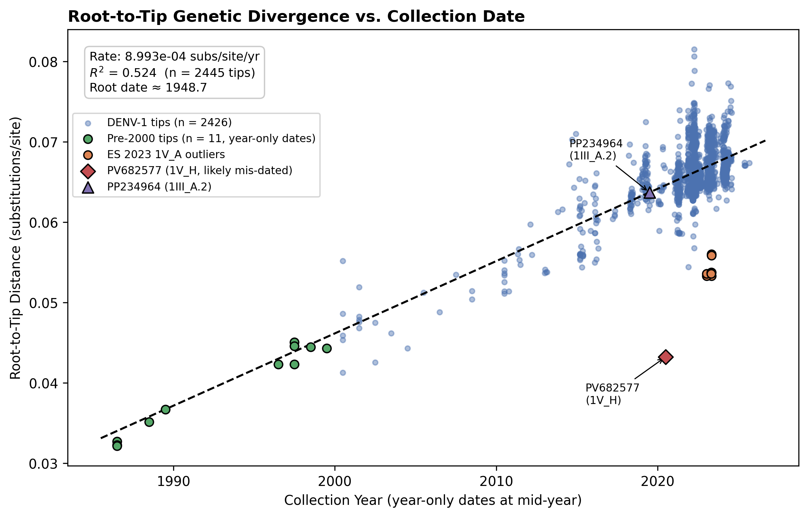
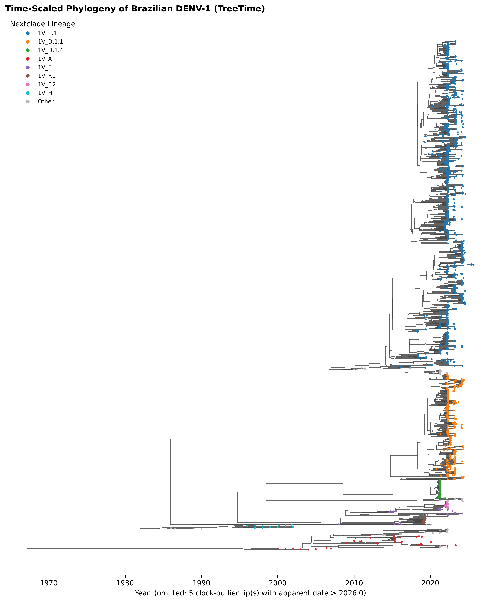

# dengue-br-phylo: DENV-1 in Brazil

Small time-tree philogeny of dengue virus genotype 1 in Brazil.
___
### **Sequence Data and Curation**

Dengue virus genomes from Brazil (≥ 10,000 nt) were retrieved from NCBI Virus (<https://www.ncbi.nlm.nih.gov/labs/virus/vssi/>) at the species level (*Orthoflavivirus denguei*), with no restriction on collection date, host, or curator-assigned completeness flag, yielding 4,261 entries across all four serotypes (DENV-1 2,666; DENV-2 1,408; DENV-3 97; DENV-4 86; 4 records with no serotype designation). Sequences were downloaded in `.fasta` format with accession-only definition lines, and metadata as a separate `.csv` table retaining all available fields.

Dengue virus serotype 1 (DENV-1) genome sequences and associated metadata were curated using a custom Python script **(1)**. NCBI version suffixes were stripped from all accessions and records were assigned to serotype via regular expression. Entries from laboratory-derived or passaged material (n = 0) and sequences with >30% non-ACGT characters (n = 1) were excluded, Brazilian federative units were resolved to 2-letter codes and municipality names were standardized, identical sequences (n = 22) were deduplicated, and repeated isolate names (n = 12) were collapsed to the least ambiguous or to the longest sequence. Collection dates were retained as given for full dates, assigned to the 15th of the month for year-month entries, and encoded as one-year intervals (`[YYYY.0:YYYY.999]`) for year-only entries (n = 56 flagged and retained; n = 1 unparseable removed), yielding 2,630 curated DENV-1 genomes.

### **Quality Control, Lineage Assignment, and Alignment**

Quality control, lineage assignment, and reference-based alignment were performed with Nextclade (v3.29.1) using the `community/v-gen-lab/dengue/denv1` dataset (version `2026-10-06--17-37-18Z`, "experimental"). Four QC rules were active in this dataset (qc.missingData, qc.privateMutations, qc.frameShifts, and premature stop codons) **(2)**.

Nextclade aligns each sequence independently against the reference genome, producing a reference-anchored alignment of uniform length in reference coordinates, and assigns genotype and lineage (under the dengue lineage nomenclature). Genotype was assigned *de novo*; of the original 2,666 DENV-1 records, serotype ("1" only) was present in 1,783, an actual genotype for 50, and was empty for 833; the field is submitter-supplied and not uniformly populated. Sequences assigned an overall QC status of `bad` (n = 183) were excluded using SeqKit (v2.14.0), while `mediocre` sequences (n = 103) were retained, resulting in a final reference-anchored alignment of 2,447 genomes (10,735 columns) **(3)**.

### **Phylogenetic and Temporal Analyses**

Maximum-likelihood (ML) phylogenetic inference was performed on the Nextclade alignment in IQ-TREE (v3.1.4) under a fixed `GTR+F+G4` substitution model with automatic thread selection (`-T AUTO`); no branch support was calculated here **(4)**. Temporal signal was evaluated by root-to-tip regression in TreeTime (v0.12.1; `treetime clock`) using least-squares rooting **(5)**. A time-scaled phylogeny was then inferred in TreeTime using `--clock-filter 4` to exclude temporal outliers and `--stochastic-resolve` to resolve large polytomies **(6)**. Because TreeTime re-estimates branch lengths under a single-rate GTR model without among-site rate heterogeneity, the root-to-tip regression rate derived from the `GTR+F+G4` ML branch lengths is reported as the primary substitution-rate estimate. No TempEst inspection or Bayesian phylodynamic inference (e.g., BEAST) was performed.

### **Alignment Sensitivity Analysis**

To verify that reference-anchored alignment did not bias branch-length or evolutionary-rate estimates, the 2,447 QC-passing unaligned sequences were independently aligned with MAFFT (v7.526; `--auto`, 11,043 columns) **(7)**. Branch lengths were re-estimated on the fixed ML topology (`-te`) under the `GTR+F+G4` model in IQ-TREE **(8)**, and root-to-tip clock regression was repeated in TreeTime (`treetime clock`) **(9)**.

---

# List of commands

**1.** Dataset curation

`python3 scripts/01_curate.py --stem all_denv_sequences --serotype 1`

**2.** Nextclade reference-anchored alignment

```
nextclade dataset get --name community/v-gen-lab/dengue/denv1 --output-dir 02_qc/dataset-denv1

nextclade run --input-dataset 02_qc/dataset-denv1 --output-tsv 02_qc/out/nextclade.tsv --output-fasta 02_qc/aligned_nextclade.fasta 01_metadata/curated.fasta
```

**3.** Finding and filtering `bad` sequences

`bash scripts/list_qc_failures.sh`

```
seqkit grep -v -f 02_qc/qc_bad.txt 01_metadata/curated.fasta     > 02_qc/qc_passed.fasta
seqkit grep -v -f 02_qc/qc_bad.txt 02_qc/aligned_nextclade.fasta > 02_qc/aligned_qc_passed.fasta
seqkit stats 02_qc/qc_passed.fasta 02_qc/aligned_qc_passed.fasta
```

`bash scripts/filter_check.sh`

`python3 scripts/verify_qc_bad.py`

**4.** (Quick) Maximum-likelihood phylogeny on the nextclade alignment

`iqtree -s 02_qc/aligned_qc_passed.fasta -m GTR+F+G4 -T AUTO --prefix 04_tree/denv1_quick`

> For the full one, which was not done here:
> `iqtree -s 02_qc/aligned_qc_passed.fasta -m MFP -B 1000 --alrt 1000 -T AUTO --prefix 04_tree/denv1`

**5.** Molecular clock regression

`treetime clock --tree 04_tree/denv1_quick.treefile --aln 02_qc/aligned_qc_passed.fasta --dates 02_qc/dates_qc_passed.csv --outdir 05_timetree/clock_quick`

**6.** Building the time-scaled tree from the ML tree

* First time-scaled tree (with default polytomy resolution)

`treetime --tree 04_tree/denv1_quick.treefile --aln 02_qc/aligned_qc_passed.fasta --dates 02_qc/dates_qc_passed.csv --clock-filter 4 --outdir 05_timetree/full`

* Final time-scaled tree (with stochastic polytomy resolution)

`treetime --tree 04_tree/denv1_quick.treefile --aln 02_qc/aligned_qc_passed.fasta --dates 02_qc/dates_qc_passed.csv --clock-filter 4 --stochastic-resolve --outdir 05_timetree/full_stoch`

**7.** Independent alignment of the QC-passed sequences with MAFFT

`mafft --auto --thread -1 02_qc/qc_passed.fasta > 03_align/aln_mafft.fasta`

**8.** Re-estimation of branch lengths on the fixed ML tree topology

`iqtree -s 03_align/aln_mafft.fasta -te 04_tree/denv1_quick.treefile -m GTR+F+G4 -T AUTO --prefix 04_tree/denv1_mafft_bl`

**9.** Checking molecular clock sensitivity to alignment method

`treetime clock --tree 04_tree/denv1_mafft_bl.treefile --aln 03_align/aln_mafft.fasta --dates 02_qc/dates_qc_passed.csv --outdir 05_timetree/clock_mafft_bl`

**10. (Extra)** Check where the outliers in a timetree come from:

`python3 scripts/verify_outliers.py`

___
### Dataset, QC, and sampling

The NCBI Virus dataset (Brazil, >10,000 nt) returned 4,261 records across four serotypes, 2,666 of which were DENV-1 (62.6%). Curation retained 2,630 of 2,666 (98.6%), wherein one record with >30% non-ACGT characters and 1 with an unparseable date were removed, 22 identical sequences and 12 repeated isolate names were corrected. No record matched a laboratory-derived/passaged filter. Nextclade QC then marked 183 sequences `bad`, 103 `mediocre` (retained) and 2,344 `good`, leaving 2,447 of 2,666 (91.8%) for tree building.

Of the 183 `bad` sequences, 180 (98.4%) failed the missing-data rule ("missingDataThreshold": 1000 Ns, "scoreBias": 100), 174 of
them on that rule alone (while the other 6 also scored `mediocre` or `bad` on
frameshifts). The remaining 3 failed on frameshifts or private mutations. The majority of QC losses are concentrated in two submitting groups (175 of 183; 95.6%): USP-Ribeirão Preto lost 98 of 666 sequences (14.7%) and Universidade Feevale lost 77 of 109 (70.6%), likely due to amplicon dropout/regions that failed to amplify. All other submitters together lost 8.

**Table 1. Record Counts After Each Curation Step**

| Step | Removed | Retained |
|---|---:|---:|
| Downloaded from NCBI Virus — 4261 FASTA records | — | 4261 |
| Organism name matches DENV-1 | 1595/4261 (37.4%) | 2666/2666 (100.0%) |
| Ambiguity filter — >30% non-ACGT removed; finer QC left to Nextclade | 1/2666 (0.0%) | 2665/2666 (100.0%) |
| Collection date parseable | 1/2665 (0.0%) | 2664/2666 (99.9%) |
| Year-only collection dates retained as TreeTime ranges — 56 records | — | 2664/2666 (99.9%) |
| Records without a resolvable state retained and flagged — 119 records | — | 2664/2666 (99.9%) |
| Collapsed identical sequences | 22/2664 (0.8%) | 2642/2666 (99.1%) |
| Collapsed repeated isolate names | 12/2642 (0.5%) | 2630/2666 (98.6%) |
| **Final curated set** (`curated.fasta`) | — | 2630/2666 (98.6%) |

Of the 2,447 remaining sequences, 2,228 (91.1%) were collected in 2021 or later, with 1,128 sequences (46.1%) comprising 2022 alone. Only 11 sequences predate 2000, and all
11 have year-only dates (56 sequences in total have year-only dates, 16
year-month, 2,375 full dates). Representation by federative unit was also unequal, with zero entries from MG, RN, and RR, while RS (613 records), MS (309), SP (299), and GO (239) were the largest contributors to the dataset. However, 116 sequences had no state attribution, with 77 stating only "Brazil", and 39 had location text that could not be resolved (for example, municipalities with whose names are present in more than one state; manually checking the contributor or submitting group could theoretically resolve this, though). The largest single submitting group (Universidade do
Estado da Bahia, DCET-1) accounts for 959 of the 2,630 curated sequences
(36.5%) (Fig. 1).



### Lineages and Molecular Clock

**Table 2. Lineage Summary**

| Lineage | Sequences (n) | Share (%) | Year Range | States (n) |
|---|---:|---:|---|---:|
| `1III_A.2` | 1 | 0.04% | 2019 | 0 |
| `1V` | 5 | 0.20% | 1986–1989 | 1 |
| `1V_A` | 60 | 2.45% | 2000–2023 | 6 |
| `1V_A.1` | 30 | 1.23% | 2013–2022 | 5 |
| `1V_A.2` | 10 | 0.41% | 2021–2022 | 2 |
| `1V_B` | 1 | 0.04% | 2019 | 0 |
| `1V_C` | 1 | 0.04% | 2020 | 1 |
| `1V_D.1.1` | 507 | 20.72% | 2020–2024 | 13 |
| `1V_D.1.4` | 90 | 3.68% | 2021 | 2 |
| `1V_D.2` | 14 | 0.57% | 2021–2024 | 4 |
| `1V_E` | 9 | 0.37% | 2010–2017 | 1 |
| `1V_E.1` | 1572 | 64.24% | 2015–2025 | 21 |
| `1V_E.2` | 21 | 0.86% | 2020–2022 | 2 |
| `1V_F` | 40 | 1.63% | 2008–2024 | 11 |
| `1V_F.1` | 38 | 1.55% | 2019–2022 | 2 |
| `1V_F.2` | 32 | 1.31% | 2021–2022 | 2 |
| `1V_H` | 16 | 0.65% | 1996–2020 | 3 |

Root-to-tip regression on the GTR+F+G4 maximum-likelihood tree gave 9.03 x 10^-4 substitutions/site/year (TreeTime; r^2 = 0.551, n = 2,437, root about 1949). Re-estimating branch lengths on the MAFFT alignment with the topology fixed gave 8.79 x 10^-4 (r^2 = 0.52, root about 1947). Re-plotting only the tips from `rtt.csv` with year-only dates at mid-year gave 8.99 x 10^-4 and r^2 = 0.524 (Fig. 2).



The time-scaled tree (TreeTime, `--clock-filter 4`) estimates the root at 1967.2 (Fig. 3) with a rate of 5.66 x 10^-4 (5.72 x 10^-4 without `--stochastic-resolve`, or `full` vs. `full_stoch`). Both rates are within the range reported for DENV-1, with several co-circulating lineages. 



However, a small set of records are observably inconsistent. Ten entries were identified as outliers on the Nextclade regression tree (11 on the MAFFT tree), and 13 in the full time-tree runs; PV682577 (1V_H, with a year-only date in 2020, was placed about 24 years too early) and PP234964 (which was assigned a non-1V lineage, 1_III_A.2). Moreover, six records from the state of ES collected in 2023 were labeled as 1V_A, whose divergence match sequences sampled about 15 years earlier and come from the largest submitter in the dataset, suggesting errors in batch-level processing or dating differences, and not real biological issues. Alternatively, the ES outliers could indeed be a real, long-undersampled 1V_A lineage. Finally, the dataset from NCBI Virus reflects sequences and, most importantly, deposits and cannot be read as prevalence of one lineage or another in different states. 

**Table 3. Outliers**

| Accession | Lineage | State | Given Data | Apparent Date | Collection Date | TreeTime Date |
|---|---|---|---|---|---|---|
| `PP234964` | `1III_A.2` | nan | 2019.49 | 2045.71 | 2019-07-01 | 2019-07-01 |
| `PV205900` | `1V_A` | ES | 2023.33 | 2009.17 | 2023-05-02 | 2023-05-02 |
| `PV205870` | `1V_A` | ES | 2023.04 | 2009.08 | 2023-01-17 | 2023-01-17 |
| `PV205875` | `1V_A` | ES | 2023.04 | 2009.43 | 2023-01-16 | 2023-01-16 |
| `PV205911` | `1V_A` | ES | 2023.34 | 2009.64 | 2023-05-05 | 2023-05-05 |
| `PV205883` | `1V_A` | ES | 2023.31 | 2009.61 | 2023-04-24 | 2023-04-24 |
| `PV205889` | `1V_A` | ES | 2023.31 | 2009.43 | 2023-04-24 | 2023-04-24 |
| `OR258460` | `1V_A.1` | MS | 2022.26 | 2039.75 | 2022-04-06 | 2022-04-06 |
| `PV682577` | `1V_H` | nan | 2020.4995 | 1996.15 | 2020 | [2020.0:2020.999] |
| `MW377899` | `1V_F` | AP | 2014.94 | 2028.33 | 2014-12-10 | 2014-12-10 |
| `OR518260` | `1V_E.1` | TO | 2022.11 | 2035.48 | 2022-02-10 | 2022-02-10 |
| `OR258487` | `1V_E.1` | MS | 2022.26 | 2039.13 | 2022-04-06 | 2022-04-06 |
| `OR258539` | `1V_E.1` | MS | 2022.29 | 2036.36 | 2022-04-16 | 2022-04-16 |
